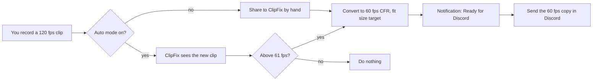

# DiscordConverterFix: Plan

Status: planning. No code yet.
Last update: 2026-11-27.

## 1. The problem

1. You record Mobile Legends clips at 120 fps.
2. You send a clip to a Discord chat.
3. The clip in Discord looks like 15 to 30 fps. It is choppy.
4. When you first convert the clip to 60 fps, Discord shows it smooth.

The goal: send smooth clips to Discord with no manual work each time.

## 2. What the research found

### 2.1 Facts (from Discord's own help pages)

| Fact | Source |
|---|---|
| The Discord **mobile app always compresses video uploads**. You choose the quality, but you cannot turn compression off. | Video Upload Quality Settings on Mobile FAQ |
| Mobile quality levels (no Nitro): Best = 720p, Standard (default) = 480p, Data Saver = 360p. With Nitro: 1080p / 720p / 360p. | Same FAQ |
| Data Saving Mode forces 360p on mobile data, even when you select Best. | Same FAQ |
| The FAQ says nothing about frame rate. Discord does not document what it does with 120 fps. | Same FAQ |
| Free upload limit is **20 MB** (since August 2026). Nitro Basic = 50 MB. Nitro = up to 1 GB. | File Attachments FAQ |
| Discord now checks the size of the **original** file, **before** compression. Android users hit the limit more often because phone files are large. | File Attachments FAQ |
| Discord plays MP4 video in H.264, HEVC (H.265) or AV1. | File Attachments FAQ |
| A user report from 2020 says Discord plays 120 fps clips with stutter until each keyframe, and at 60 fps maximum. Discord never replied. | Discord feedback forum, "Playback of 120fps videos" |

### 2.2 Why 120 fps clips go bad (best explanation, not proven yet)

Discord does not publish how its mobile compressor works. These are the likely causes:

1. **The compressor is tuned for 30 or 60 fps.** A 120 fps clip has 2 times the frames of a 60 fps clip. The compressor must drop frames or share the same bitrate across more frames. Both make the result look worse.
2. **Phone screen recordings use a variable frame rate (VFR).** The time between frames changes all the time (for example 8 ms, then 11 ms, then 9 ms). A simple "drop every second frame" rule then gives uneven gaps. Uneven gaps feel like 15 to 30 fps, even when the average is higher.
3. **Hardware encoder limits.** Some phone encoders cannot encode 120 fps at high resolution. They then skip frames.
4. **Playback limits.** The Discord player has a history of bad 120 fps playback (see 2.1). Most viewers also have 60 Hz screens, so 120 fps gives them no benefit.

Your own test supports this: a 60 fps copy goes through the same compressor and stays smooth. The compressor works well when it gets a 60 fps, constant-frame-rate file.

**Phase 0 (section 7) proves or rejects these causes before we build anything.**

### 2.3 Can we fix Discord's conversion itself?

**No, not in a safe way.**

- The compressor runs inside the closed Discord app and on Discord's servers. We cannot change it.
- Client mods (for example Vencord or BetterDiscord) break the Discord Terms of Service. They put your account at risk. They also do not work in the normal mobile app.
- Android does not let one app change a file that another app sends. This is a security rule. Only a rooted phone can get around it.

So the safe fix is: **give Discord a file that it handles well.** That is a 60 fps, constant-frame-rate H.264 MP4 that fits the size limit. This is what your manual 60 fps conversion already does. The project makes that step automatic.

## 3. Honest check: do we need to build anything?

Before we build, try the free options:

| Option | How | Good | Bad |
|---|---|---|---|
| **0. Record at 60 fps** | Set the screen recorder to 60 fps. The game still runs at 120 fps. Only the recording changes. | No app, no extra step, smaller files. | You lose 120 fps originals (for TikTok, YouTube, or edits). |
| **1. Manual convert** (what you do now) | Export at 60 fps in an editor (for example CapCut). | Works today. | Manual work for each clip. |
| **2. This project** | An app converts every new 120 fps clip to 60 fps by itself. | No editing. On/off switch. | We must build and maintain it. |

**Recommendation:** If Discord is the only place your clips go, try option 0 first. It can solve the problem with zero code. Build this project if you want to keep 120 fps originals, or if option 0 does not fix it.

## 4. The key question: where do you send clips from?

The answer decides what we build. This PC has an Android emulator installed (MuMu Player), so Mobile Legends on PC is possible too.

| You record on | You send from | What goes wrong | What we build |
|---|---|---|---|
| Android phone | Discord Android app | Mobile compressor (720p/480p) handles 120 fps badly. Also the 20 MB check on the original file. | **Android app** (section 6.1) |
| iPhone | Discord iOS app | Same mobile compressor. | iOS is harder (see 5, option E). |
| Phone | Discord on PC | Desktop does not compress, but the 120 fps playback stutters, and big files hit 20 MB. | **Windows tray app** (section 6.2) |
| Emulator or OBS on PC | Discord on PC | Same as above. | **Windows tray app** (section 6.2) |

## 5. All options compared

| # | Option | Fixes mobile sends? | Automatic? | Effort | Risk | Verdict |
|---|---|---|---|---|---|---|
| A | **Android app**: share target + auto-convert switch | Yes | Yes (auto mode) | Medium | Low | **Build if you send from Android** |
| B | **Windows tray app**: watch folder + auto-convert + copy to clipboard | Only for sends from PC | Yes | Low | Low | **Build if you send from PC** |
| C | Discord bot that re-encodes clips | **No.** The bot gets the clip after the mobile app already damaged it. | Yes | Medium | Medium (hosting, bot repost is not your message) | Reject |
| D | Discord client mod (desktop plugin) | No (desktop only) | Yes | Medium | **High** (breaks Terms of Service, breaks on Discord updates) | Reject |
| E | iOS app or Shortcut | Yes | Partly | High | Medium | Later. An iOS app needs a paid Apple developer account (99 USD per year) to stay installed. A free install expires after 7 days. |
| F | Termux + ffmpeg + Tasker on Android | Yes | Yes | Low code, but fiddly | Medium | Prototype only. Software encode on the phone CPU is slow and hot. |
| G | Send as a generic file (zip or renamed) to skip compression | Yes | No | None | Low | Reject. Friends must download the file. No inline player. |

## 6. Recommended design

Build only the platform you need first. Both designs share the same output rules.

### 6.0 Shared output rules ("Discord-safe profile")

| Setting | Value | Why |
|---|---|---|
| Frame rate | **60 fps, constant** (CFR) | Smooth, and the compressor handles it well. |
| Codec | H.264, High profile, yuv420p | Plays everywhere. HEVC fails on some PCs and browsers. |
| Resolution | Keep, or scale down to 1080p or 720p (setting) | Discord mobile scales to 720p (no Nitro) anyway. A smaller file passes the 20 MB check. |
| Size target | 20 MB (free), 50 MB (Nitro Basic), 1 GB (Nitro) (setting) | Discord checks the original file size. The tool sets the bitrate from size and length. |
| Audio | AAC, copy if possible, else 128 kbit/s | Keep game sound. |
| Container | MP4 with "faststart" | Discord can start playback before the full download. |
| Skip rule | Skip a clip if its frame rate is 61 fps or less | Do not touch clips that are already fine. |
| Originals | **Never delete or change the original** | Safety. You keep your 120 fps clip. |

### 6.1 Android app (working name: "ClipFix")

Use a neutral name. Do not use the Discord logo or name as the app name.

**Two modes:**

1. **Share mode (always available).**
   1. Open a clip in the gallery.
   2. Tap Share, then tap ClipFix.
   3. ClipFix converts the clip. A notification shows the progress.
   4. The Android share sheet opens with the 60 fps file.
   5. Tap the Discord chat.
2. **Auto mode (the on/off switch).**
   1. You turn on Auto mode one time in the settings. It stays on, also after a restart.
   2. You record a clip as usual.
   3. ClipFix sees the new video in the recordings folder.
   4. If the clip is above 61 fps, ClipFix makes a 60 fps copy in a "ClipFix" album.
   5. A notification says "Ready for Discord". It has a Share button.
   6. In Discord, the newest video in your gallery is the 60 fps copy. Send it.

**Catch:** ClipFix cannot change the file inside Discord's upload screen (see 2.3). You still pick the 60 fps copy. But you do no editing.



**Technology:**

| Part | Choice | Why |
|---|---|---|
| Language and UI | Kotlin, Jetpack Compose | Standard for new Android apps. |
| Video engine | **Android Media3 Transformer** | Uses the phone's hardware encoder. Fast and low battery use. `EditedMediaItem.Builder.setFrameRate()` (Media3 1.10+) or `FrameDropEffect` lowers 120 fps to 60 fps. |
| New-clip detection | MediaStore content observer + WorkManager | Starts work only when a new video appears. No battery drain while idle. |
| Long conversions | Foreground service, type `mediaProcessing` (Android 15+) | Android stops background work that runs too long. |
| Install | Sideload the APK from GitHub Releases | No Play Store account needed. |

**Settings screen:** Auto mode (on/off), recordings folder, resolution (Keep / 1080p / 720p), size target (20 MB / 50 MB / 1 GB), auto-delete old converted copies after N days (copies only, never originals).

**Android catches:**

- Android 13+ needs the "videos" permission. Auto mode needs full access, not "selected videos only".
- Some phone brands (Xiaomi, Oppo, Vivo, Realme and others) stop background apps to save battery. You may need to set ClipFix to "No restrictions" in the battery settings.
- Each copy uses phone storage. The auto-delete setting handles this.

### 6.2 Windows tray app (working name: "ClipFix for PC")

**Flow:**

1. ClipFix sits in the system tray. The tray menu has "Auto mode: on/off".
2. ClipFix watches one or more folders (for example the emulator's recordings folder or the OBS folder).
3. A new clip above 61 fps appears. ClipFix makes a 60 fps copy in a "Discord-ready" folder.
4. ClipFix puts the copy on the clipboard and shows a notification.
5. In Discord, press Ctrl+V to attach the clip. Press Enter to send.

Other ways in: drag a clip onto the tray icon, or right-click a file and select "Send to > ClipFix".

**Technology:**

| Part | Choice | Why |
|---|---|---|
| Video engine | **ffmpeg** (bundled) | Free, fast, handles all inputs including VFR. |
| Encoder | Hardware first (Intel QSV, NVIDIA NVENC, AMD AMF), `libx264` as fallback | Speed. |
| App | Python with a tray library and a folder watcher, packed into one .exe | Simple to read and learn from. Small. |

**Measured on a mid-range Windows laptop:** a 20 second 1080p 120 fps test clip converts to 60 fps in about 10 seconds (about 2 times faster than real time). The output has exactly 60 fps and half the frames (2400 to 1200). This is a synthetic test clip, not a real game clip.

The core conversion is one ffmpeg command:

```text
ffmpeg -i in.mp4 -vf fps=60 -c:v libx264 -preset veryfast -crf 23 -c:a copy -movflags +faststart out_60fps.mp4
```

## 7. Phases

### Phase 0: Prove the cause (no code, about 30 minutes)

1. Pick one 120 fps clip of 10 to 20 seconds.
2. Make a 60 fps copy with your current method.
3. Send both clips to a private test chat, from your normal device.
4. Download both clips back from Discord.
5. Run this command on all 4 files and compare the results:

   ```text
   ffprobe -v error -select_streams v:0 -show_entries stream=codec_name,width,height,r_frame_rate,avg_frame_rate,nb_frames,bit_rate -of default=nw=1 FILE.mp4
   ```

6. Record a short clip at 60 fps (option 0). Send it. Check if it is smooth.
7. Write the results in `docs/findings.md`.

**Decision gate:** If option 0 is good enough and you do not need 120 fps originals, stop here. Else, continue.

### Phase 1: Output rules and test clips

1. Make a set of test clips: 120 fps CFR, 120 fps VFR, 90 fps, 60 fps (must skip), portrait, 1 minute long, HEVC input, clip with no audio.
2. Lock the output rules from section 6.0.
3. Confirm each converted test clip plays smooth on Discord desktop and Discord mobile.

### Phase 2: Minimum app (manual mode)

- Android: Share mode only.
- Windows: drag-and-drop only.
- Done when: a 120 fps clip goes in, a smooth 60 fps clip under the size target comes out, and it plays smooth in Discord.

### Phase 3: Auto mode with the on/off switch

- Android: MediaStore watcher, notification with a Share button.
- Windows: folder watcher, clipboard copy, tray switch.
- Done when: you record a clip and the 60 fps copy is ready with zero taps. The switch stays set after a restart.

### Phase 4: Polish and release

- Settings screen, size targets, auto-delete of copies.
- Build the APK or .exe in GitHub Actions. Attach it to GitHub Releases.
- Write a README with install steps and screenshots.

### Phase 5 (optional): Second platform

Build the other app (Android or Windows) only if you need it.

## 8. Risks and catches

| Risk | Effect | What we do |
|---|---|---|
| We cannot hook into Discord's upload. | You still pick the 60 fps copy by hand. | Make the copy the newest gallery item and add a Share button in the notification. |
| Discord changes its compressor. | The fix can stop working, or stop being needed. | Run Phase 0 again after big Discord updates. |
| 20 MB limit on the original file. | Long clips fail before compression. | Size target setting. The tool lowers the bitrate or resolution to fit. |
| Phone battery and heat. | Bad experience. | Hardware encoder only. Work only when a new clip appears. |
| Phone brands kill background apps. | Auto mode stops. | Battery setting guide in the README. Share mode always works. |
| Public repo. | Private clips could leak. | `.gitignore` blocks video files. Never commit clips or screenshots. |
| iPhone users. | Not covered by the first version. | Option E, later. |

## 9. Open questions

1. Where do you record clips: phone screen recorder, the Mobile Legends built-in recorder, MuMu Player on PC, or OBS?
2. Which device do you send clips from: Android phone, iPhone, or PC?
3. Which phone model? (Battery rules and encoder limits change by brand.)
4. Do you have Nitro? (This sets the size target.)
5. How long is a normal clip?
6. Do you need the 120 fps originals for other places, like TikTok or YouTube? If no, option 0 can be enough.
7. Is this only for you, or for friends too later? (Friends mean more polish and maybe a Play Store release.)

## 10. Definition of done

1. A 120 fps clip sent through ClipFix plays smooth (60 fps) for viewers on Discord desktop and mobile.
2. You do no editing. At most, you pick the 60 fps copy in Discord.
3. The on/off switch works and stays set after a restart.
4. The file fits your upload limit.
5. The original 120 fps clip stays unchanged.

## 11. Planned repo layout

```text
plan.md          this plan
docs/findings.md Phase 0 results
android/         Android app (if chosen)
windows/         Windows tray app (if chosen)
testclips/       ignored by git, local test clips only
```

## Sources

- [Discord: Video Upload Quality Settings on Mobile FAQ](https://support.discord.com/hc/en-us/articles/9665451164951-Video-Upload-Quality-Settings-on-Mobile-FAQ)
- [Discord: File Attachments FAQ](https://support.discord.com/hc/en-us/articles/25444343291031-File-Attachments-FAQ)
- [Discord feedback forum: Playback of 120fps videos](https://support.discord.com/hc/en-us/community/posts/360051360753-Playback-of-120fps-videos)
- [Discord feedback forum: Forced terrible compression on mobile video uploads](https://support.discord.com/hc/en-us/community/posts/22949265359895-Forced-terrible-compression-on-mobile-video-uploads)
- [Dexerto: Discord raises free upload limit to 20MB](https://www.dexerto.com/entertainment/discord-raises-free-upload-limit-to-20mb-after-lowering-it-two-years-ago-3398251/)
- [Android Developers: Media3 FrameDropEffect](https://developer.android.com/reference/androidx/media3/effect/FrameDropEffect)
- [Android Developers: Media3 Transformer transformations](https://developer.android.com/media/media3/transformer/transformations)
- [Android Developers blog: Media3 1.10 is out](https://developer.android.com/blog/posts/media3-1-10-is-out)
- [Samsung Community: screen recorder capped at 60 fps in Mobile Legends](https://r1.community.samsung.com/t5/gaming-hub/screen-recorder/td-p/21022645)
- [OBS forum: high FPS recordings guide](https://obsproject.com/forum/resources/how-to-troubleshoot-high-fps-recordings-120-144-240-300-fps-recording.1433/updates)
